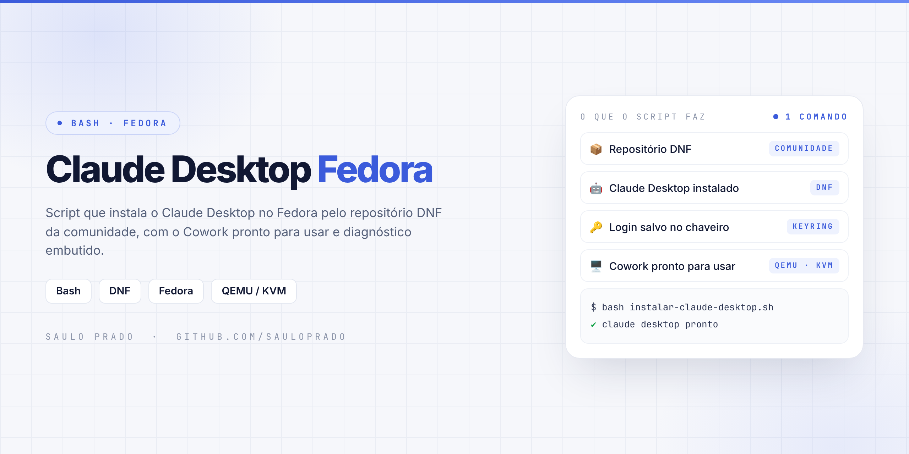
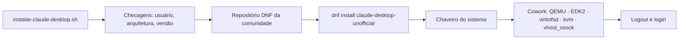

<p align="center">

</p>

<h1 align="center">Claude Desktop Fedora</h1>
<p align="center"><i>Script que instala o Claude Desktop no Fedora, com o Cowork pronto para usar, em um único comando</i></p>

<p align="center">


</p>

## Sumário

- [Sobre](#sobre)
- [Oficial ou da comunidade?](#oficial-ou-da-comunidade)
- [Requisitos](#requisitos)
- [O que o script faz](#o-que-o-script-faz)
- [Como funciona](#como-funciona)
- [Como executar](#como-executar)
- [Depois da instalação](#depois-da-instalação)
- [Atualizar e remover](#atualizar-e-remover)
- [Problemas comuns](#problemas-comuns)
- [Estrutura do repositório](#estrutura-do-repositório)
- [Projetos irmãos](#projetos-irmãos)
- [Créditos](#créditos)
- [Autor](#autor)

## Sobre

Automação em **Bash** que instala o Claude Desktop no Fedora e prepara o **Cowork**, que no Linux roda tarefas em uma máquina virtual com QEMU e KVM.

Feito para **Fedora Workstation 40 ou superior** (GNOME ou KDE).

## Oficial ou da comunidade?

A Anthropic publica o Claude Desktop para Linux (beta) **só em `.deb`**, para Ubuntu e Debian. Para o Fedora ainda não existe pacote oficial: a [documentação](https://code.claude.com/docs/en/desktop-linux) diz que outras distribuições virão no futuro.

Enquanto isso, este script usa o repositório DNF do projeto da comunidade [claude-desktop-debian](https://github.com/aaddrick/claude-desktop-debian), que **reempacota o `.deb` oficial** em `.rpm` (pacote `claude-desktop-unofficial`). O app é o mesmo; muda só o empacotamento, que ganha um lançador e o diagnóstico `--doctor`.

> Quando a Anthropic lançar o pacote oficial para Fedora, este script passa a usá-lo.

## Requisitos

| Item | Mínimo |
| --- | --- |
| 🐧 Sistema | Fedora 40 ou superior |
| 🧩 Arquitetura | x86_64 ou aarch64 |
| ⚙️ Cowork | Virtualização (VT-x / AMD-V) ativada na BIOS/UEFI |

## O que o script faz

| Etapa | Na prática | Ferramenta |
| --- | --- | --- |
| 🔎 Checagens | Bloqueia root, valida arquitetura e a versão do Fedora | `os-release` |
| 📦 Repositório | Registra o repositório DNF em `/etc/yum.repos.d/claude-desktop-unofficial.repo` | DNF |
| 🤖 Claude Desktop | Instala o `claude-desktop-unofficial` (a chave GPG do repositório é aceita na primeira instalação) | DNF |
| 🔑 Login salvo | Garante o chaveiro do sistema (GNOME Keyring ou KDE Wallet) | `gnome-keyring` |
| 🖥️ Cowork | QEMU + firmware UEFI + virtiofsd, grupo `kvm` e módulo `vhost_vsock` carregado em todo boot | QEMU · EDK2 · KVM |

## Como funciona



## Como executar

```bash
git clone https://github.com/sauloprado/claude-desktop-fedora.git
cd claude-desktop-fedora

# instalação completa (app + Cowork)
bash instalar-claude-desktop.sh

# só o app, sem preparar o Cowork
bash instalar-claude-desktop.sh --sem-cowork
```

> Rode como seu usuário normal, **sem `sudo`**: o script pede a senha só quando precisa instalar pacotes. Pode rodar de novo quantas vezes quiser.

## Depois da instalação

| Passo | Como |
| --- | --- |
| Reentrar | Se o script avisar, faça **logout e login** para o grupo `kvm` valer |
| Abrir | Menu de aplicativos → **Claude**, ou `claude-desktop-unofficial` no terminal |
| Entrar | Conta do claude.ai ou SSO da sua organização |
| Diagnóstico | `claude-desktop-unofficial --doctor` mostra o que falta para o Cowork, Wayland e chaveiro |

## Atualizar e remover

```bash
# atualizar (chega junto com as atualizações do sistema)
sudo dnf upgrade

# remover
sudo dnf remove claude-desktop-unofficial
sudo rm -f /etc/yum.repos.d/claude-desktop-unofficial.repo
```

## Problemas comuns

| Situação | Solução |
| --- | --- |
| `No match for argument: claude-desktop-unofficial` | `sudo dnf makecache` e confira `cat /etc/yum.repos.d/claude-desktop-unofficial.repo` |
| Login não fica salvo | `sudo dnf install gnome-keyring` e desbloqueie o chaveiro |
| Cowork requires hardware virtualization (KVM) | Ative a virtualização na BIOS/UEFI |
| Sem permissão em `/dev/kvm` | Logout e login após entrar no grupo `kvm` |
| Cowork requires the vhost_vsock kernel module | `sudo modprobe vhost_vsock` e reabra o app |
| Qualquer outra coisa | `claude-desktop-unofficial --doctor` |

## Estrutura do repositório

```text
claude-desktop-fedora/
├── instalar-claude-desktop.sh   # instalação completa (--sem-cowork opcional)
├── assets/
│   └── capa.png
├── LICENSE
└── README.md
```

## Projetos irmãos

| Projeto | Distribuição | Origem do pacote |
| --- | --- | --- |
| [claude-desktop-ubuntu](https://github.com/sauloprado/claude-desktop-ubuntu) | Ubuntu · Linux Mint · Debian | Repositório apt oficial da Anthropic |
| [claude-desktop-fedora](https://github.com/sauloprado/claude-desktop-fedora) | Fedora | Repositório DNF da comunidade |

## Créditos

O Claude Desktop é da [Anthropic](https://www.anthropic.com). O pacote `.rpm` e o repositório DNF são do projeto [claude-desktop-debian](https://github.com/aaddrick/claude-desktop-debian), de [aaddrick](https://github.com/aaddrick). Tudo é baixado das fontes originais durante a execução (nada é redistribuído aqui).

Projeto pessoal, sem vínculo com a Anthropic ou com o Projeto Fedora. Claude é marca da Anthropic; Fedora é marca da Red Hat.

## Autor

**Saulo Prado** · Analista de Sistemas · Gestão de Ativos de TI, orçamento, automação e dashboards

[](https://www.linkedin.com/in/saulo-prado-ab4a0b96/)
[](https://github.com/sauloprado)
